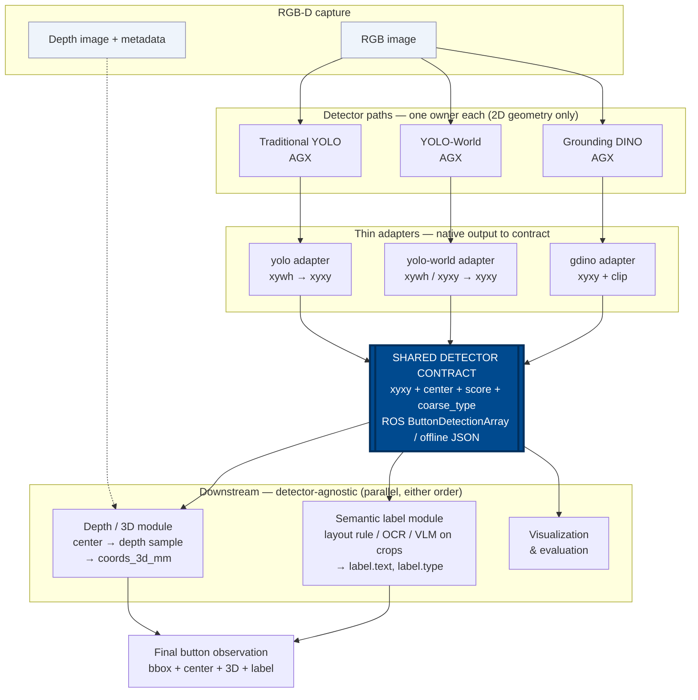

# Detector Interface Contract

This document defines the shared output contract for elevator button detector
backends. It applies to the three active detector paths:

- Traditional YOLO (Ultralytics YOLO11n Detect) on AGX
- YOLO-World on AGX
- Grounding DINO on AGX

VLM-based bounding boxes are no longer part of the detector comparison. VLM may
be used later as a crop-level semantic labeler, but it must not define the
detector geometry interface.

## Goal

Every detector backend must convert its native output into the same button
detection contract. Downstream modules such as 3D projection, layout rules,
OCR, VLM crop labeling, visualization, and evaluation must consume this shared
contract only. They must not depend on YOLO, YOLO-World, or Grounding DINO
native output fields.

The detector owns only coarse 2D geometry and detector confidence. It does not
own final button labels such as `4`, `door_open`, or `alarm`.

## Architecture Overview

The system is an hourglass. Three detector paths (top) converge to one shared
contract (the waist). Every downstream module (bottom) consumes only the
contract, so any detector can feed any downstream stage without changes.



Key boundaries shown in the diagram:

- Detector paths output **only 2D geometry** (`xyxy`, center, score, coarse
  type). They never emit final labels or 3D.
- The **adapter** is the only detector-specific code below each backend.
  Everything under the contract is shared.
- **3D** and **semantic labels** are separate downstream modules. They run on
  the contract, not on detector-native fields, and can run in either order.
- VLM / OCR live inside the label module and operate on **crops**, not on the
  detector geometry interface.

## Coordinate Rules

All detector outputs must follow these coordinate rules:

- Coordinates are pixel coordinates in the original RGB image.
- Coordinates must not be normalized to `[0, 1]`.
- The canonical bounding box format is `xyxy`:
  `[x_min, y_min, x_max, y_max]`.
- `x_min` and `x_max` are horizontal image coordinates.
- `y_min` and `y_max` are vertical image coordinates.
- The image origin is the top-left pixel.
- `x` increases to the right.
- `y` increases downward.
- `x_min < x_max`.
- `y_min < y_max`.
- Values may be floats. Do not round early unless the detector only returns
  integer boxes.
- Boxes must be clipped to the image bounds before publishing the shared
  contract:
  - `0 <= x_min < image_width`
  - `0 < x_max <= image_width`
  - `0 <= y_min < image_height`
  - `0 < y_max <= image_height`
- Invalid or zero-area boxes must be dropped before publishing.

The center must be computed from the clipped `xyxy` box:

```text
center_x = (x_min + x_max) / 2
center_y = (y_min + y_max) / 2
```

## ROS Runtime Contract

For ROS2 runtime integration, detector nodes should publish
`elevator_interfaces/msg/ButtonDetectionArray`.

The current shared message shape is:

```text
std_msgs/Header header
uint32 image_width
uint32 image_height
ButtonDetection[] detections
float32 detector_latency_ms
string backend
```

Each detection must use `elevator_interfaces/msg/ButtonDetection`:

```text
string detection_id
float32 x_min
float32 y_min
float32 x_max
float32 y_max
float32 center_x
float32 center_y
float32 detector_confidence
string coarse_type
```

### ROS Field Semantics

`header`
: Use the source RGB image header when available. This lets downstream modules
  align detections with the image and depth frame.

`image_width`, `image_height`
: Width and height of the original RGB image used by the detector.

`backend`
: Stable backend name. Recommended values:
  - `traditional_yolo`
  - `yolo_world`
  - `grounding_dino`

`detector_latency_ms`
: End-to-end detector inference and adapter time for one image, in
  milliseconds. If unavailable, use `-1.0`.

`detection_id`
: Stable within one message. Use a backend-prefixed value such as
  `yolo_world_000`, `grounding_dino_000`, or `traditional_yolo_000`.

`x_min`, `y_min`, `x_max`, `y_max`
: Clipped `xyxy` pixel box in the original RGB image.

`center_x`, `center_y`
: Center of the clipped box.

`detector_confidence`
: Detector confidence mapped to `[0, 1]`. If the backend truly has no
  confidence score, use `-1.0`. Do not invent semantic confidence here.

`coarse_type`
: A detector-level coarse category only. Recommended values:
  - `button_candidate`
  - `floor_button_candidate`
  - `door_button_candidate`
  - `panel_candidate`
  - `unknown_candidate`

Do not put final semantic labels such as `1`, `2`, `open`, `close`, or
`emergency` in `coarse_type`. Those belong to the semantic labeling stage.

## Offline JSON Contract

For benchmark files and cross-machine comparison, use this JSON structure:

```json
{
  "schema_version": "1.0",
  "source_detector": "yolo_world",
  "image": {
    "path": "pmb_inside_panel_003_rgb.jpg",
    "width": 640,
    "height": 480
  },
  "detector_latency_ms": 42.5,
  "detections": [
    {
      "id": "yolo_world_000",
      "bbox_xyxy": [446.0, 111.0, 490.0, 153.0],
      "center_xy": [468.0, 132.0],
      "score": 0.56,
      "coarse_type": "button_candidate",
      "detector_class": "button",
      "raw": {}
    }
  ]
}
```

### JSON Field Semantics

`schema_version`
: Must be `"1.0"` for this contract.

`source_detector`
: Same meaning as ROS `backend`.

`image.path`
: Path to the RGB image. Prefer a path relative to the dataset root when
  writing portable benchmark output.

`image.width`, `image.height`
: Original RGB image dimensions.

`detector_latency_ms`
: Same meaning as ROS `detector_latency_ms`. Use `-1.0` if unavailable.

`detections[].id`
: Same meaning as ROS `detection_id`.

`detections[].bbox_xyxy`
: Same geometry as ROS `x_min`, `y_min`, `x_max`, `y_max`.

`detections[].center_xy`
: Same geometry as ROS `center_x`, `center_y`.

`detections[].score`
: Same meaning as ROS `detector_confidence`.

`detections[].coarse_type`
: Same meaning as ROS `coarse_type`.

`detections[].detector_class`
: Native class, prompt, or category string from the detector. This is for
  debugging only. Downstream labelers must not rely on it.

`detections[].raw`
: Optional native detector output for debugging. Keep this small enough for
  practical logs. Do not require downstream modules to parse it.

Empty detections must be represented as:

```json
{
  "schema_version": "1.0",
  "source_detector": "grounding_dino",
  "image": {
    "path": "example.jpg",
    "width": 640,
    "height": 480
  },
  "detector_latency_ms": -1.0,
  "detections": []
}
```

## Adapter Requirements

Each detector path must provide a thin adapter from native output to this
contract. The adapter is responsible for:

- Mapping native bbox format to clipped `xyxy`.
- Computing `center_x`, `center_y`, or `center_xy`.
- Mapping native confidence to `detector_confidence` or `score`.
- Assigning stable detection IDs.
- Filling `backend` or `source_detector`.
- Filling `coarse_type`.
- Preserving optional native fields in `raw`.
- Dropping invalid boxes.

The adapter must not:

- Run semantic labeling.
- Infer floor numbers from layout.
- Read text with OCR or VLM.
- Convert 2D detections to 3D coordinates.
- Publish detector-native bbox conventions to downstream code.

## Backend-Specific Instructions

### For the Grounding DINO Agent on AGX

Grounding DINO often returns `xyxy` boxes already. The AGX Grounding DINO path
must still run its output through an adapter before any downstream use.

Required behavior:

- Use `source_detector` or ROS `backend` value `grounding_dino`.
- Convert every native detection into clipped `xyxy` pixel coordinates.
- If Grounding DINO returns normalized coordinates in any code path, multiply
  by image width and height before publishing.
- Map native `score` to `detector_confidence` or JSON `score`.
- Store the native text phrase or prompt match in `detector_class`.
- Use `coarse_type = "button_candidate"` unless there is a clear detector-only
  reason to use a more specific candidate type.
- Keep prompt text, raw label, raw score, and raw bbox in `raw` for debugging.
- Do not use Grounding DINO's text phrase as the final button label.
- Do not output `door`, `number`, or floor values as final semantics from the
  detector path.

The expected adapter shape is:

```text
Grounding DINO native output
  -> gdino adapter
  -> ButtonDetectionArray or detector contract JSON
```

### For the Traditional YOLO (YOLO11n Detect) Agent on AGX

The deployed AGX traditional YOLO path uses the official Ultralytics
**YOLO11n Detect** architecture and must publish the same contract even if the
model is trained with YOLO-native `xywh` labels. Historical artifact paths or
run IDs containing `v6` refer only to this project's sixth dataset/training
iteration; they do not identify the YOLOv6 model family.

Required behavior:

- Use `source_detector` or ROS `backend` value `traditional_yolo`.
- Convert YOLO predictions to clipped `xyxy` pixel coordinates.
- Do not publish YOLO normalized training-label coordinates.
- Map YOLO confidence to `detector_confidence` or JSON `score`.
- Store the YOLO class name in `detector_class`.
- Use `coarse_type = "button_candidate"` for generic button models.
- If the YOLO model has only detector-level classes, keep them coarse. Do not
  treat them as final button labels unless a later semantic module confirms
  them.
- Include model path, class ID, class name, and original YOLO bbox in `raw`
  when writing offline JSON.

The expected adapter shape is:

```text
YOLO11n Detect native prediction
  -> traditional YOLO adapter
  -> ButtonDetectionArray or detector contract JSON
```

### For the YOLO-World Agent on AGX

YOLO-World may return boxes through local scripts as `xywh` or as `xyxy`
depending on the code path. The adapter must normalize this before publishing.

Required behavior:

- Use `source_detector` or ROS `backend` value `yolo_world`.
- Convert native `[x, y, w, h]` boxes to `[x, y, x + w, y + h]`.
- If the specific code path already returns `xyxy`, do not convert twice.
- Map native `confidence` to `detector_confidence` or JSON `score`.
- Store the prompt class or native class name in `detector_class`.
- Use `coarse_type = "button_candidate"` for button detections.
- Keep panel detections separate from button detections. If panel candidates
  are published, use `coarse_type = "panel_candidate"`.
- Do not let downstream code depend on YOLO-World prompt strings.

The expected adapter shape is:

```text
YOLO-World native output
  -> YOLO-World adapter
  -> ButtonDetectionArray or detector contract JSON
```

## Downstream Boundary

Downstream modules may consume these fields:

- image width and height
- backend or source detector
- detection ID
- clipped `xyxy` bbox
- center point
- detector confidence
- coarse type

Downstream modules must not consume:

- native YOLO `xywh`
- native Grounding DINO labels as final semantics
- YOLO-World prompt strings as final semantics
- any field inside `raw` for production behavior

Final semantic labels should be added later in a separate observation contract,
for example:

```json
{
  "label": {
    "text": "4",
    "type": "floor_button",
    "source": "layout_rule",
    "confidence": 1.0
  }
}
```

3D coordinates should also be added later by a separate depth module:

```json
{
  "coords_3d_mm": {
    "x": 12.3,
    "y": -45.6,
    "z": 780.0,
    "source": "depth_center"
  }
}
```

Detector adapters should not write these fields.

## Depth and 3D Boundary

The detector contract intentionally does not include depth values. Detector
backends must output only 2D geometry in the RGB image frame. Depth lookup and
3D projection belong to a separate RGB-D post-processing module.

The expected data flow is:

```text
RGB-D capture
  -> RGB image + depth image + metadata
  -> detector backend
  -> 2D detector contract
  -> depth / 3D module
  -> 2D detection + center depth + 3D coordinates
```

The detector must provide a reliable `center_x`, `center_y` or `center_xy`.
The depth module then samples the depth image at that center point, or in a
small neighborhood around that center point when the exact pixel is invalid.

For AGX field collection, capture sessions should save both RGB and depth:

```text
raw_capture/<session>/
  images/
    capture_YYYYMMDD_HHMMSS_mmm.jpg
  depth/
    capture_YYYYMMDD_HHMMSS_mmm_depth.png
  metadata.jsonl
```

Depth images must be stored losslessly. For the active Gemini 335 path, use
16-bit PNG depth files, not JPEG. The registered depth stream is 1920×1080;
the unregistered device stream is 1280×800 and must not be sampled directly
with RGB detector coordinates.

The capture metadata should record at least:

```json
{
  "filename": "images/capture_YYYYMMDD_HHMMSS_mmm.jpg",
  "depth_filename": "depth/capture_YYYYMMDD_HHMMSS_mmm_depth.png",
  "rgb_topic": "/gemini335/color/image_raw",
  "depth_topic": "/gemini335/depth/image_raw",
  "width": 1920,
  "height": 1080,
  "depth_width": 1920,
  "depth_height": 1080,
  "depth_encoding": "16UC1",
  "depth_unit": "device_unit (scale pending)",
  "aligned_depth_to_color": true
}
```

`aligned_depth_to_color` is important. If it is `true`, the depth module may
use the detector center directly:

```text
depth_mm = depth_image[round(center_y), round(center_x)]
```

If it is `false`, the depth module must align depth to the RGB image frame
before sampling. Detector adapters must not perform this alignment.

The depth / 3D module may append fields such as:

```json
{
  "center_depth_mm": 780.0,
  "coords_3d_mm": {
    "x": 12.3,
    "y": -45.6,
    "z": 780.0,
    "source": "depth_center"
  }
}
```

These fields are post-detector outputs. They must not be required from YOLO,
YOLO-World, or Grounding DINO adapters.

## Acceptance Checklist

A detector path satisfies this contract when:

- It outputs `xyxy` pixel boxes in the original RGB image frame.
- It clips boxes to image bounds.
- It drops invalid or zero-area boxes.
- It computes centers from clipped boxes.
- It reports detector confidence or `-1.0`.
- It fills a stable backend name.
- It fills `coarse_type` without final semantic labels.
- It can represent empty detections.
- Its output can be consumed by shared visualization, 3D, label, and evaluation
  code without detector-specific parsing.
- It does not output depth or 3D coordinates directly.
- Its paired RGB-D capture data records depth file paths and alignment metadata
  when 3D validation is required.
